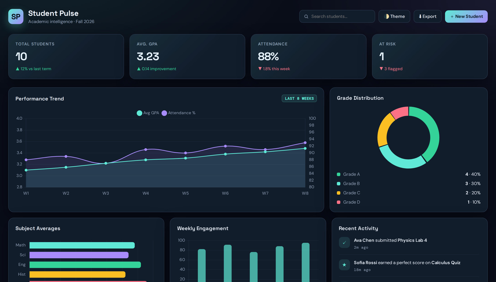
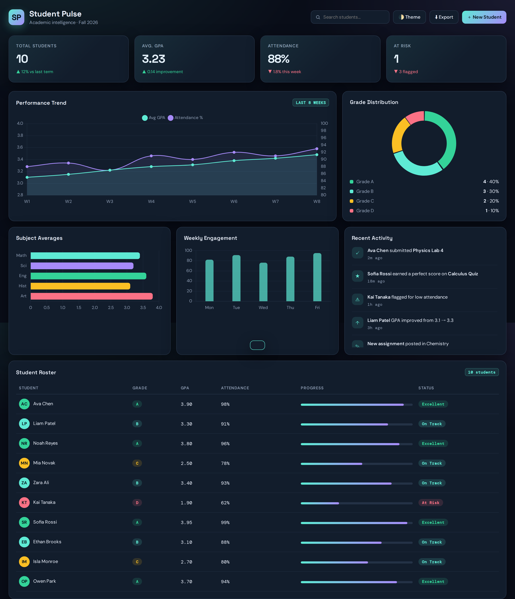

# 🎓 Student Pulse

### Academic intelligence dashboard — real-time GPA, attendance & risk analytics

**A single-file, zero-dependency dashboard that turns student data into decisions.**

<a href="https://shhoryaaa.github.io/student-pulse/"><b>🚀 Live Demo</b></a> ·
<a href="#-screenshots"><b>📸 Screenshots</b></a> ·
<a href="#-project-pipeline"><b>🏗 Pipeline</b></a> ·
<a href="#-features"><b>⚡ Features</b></a> ·
<a href="#-quick-start"><b>⚡ Quick Start</b></a>

---

## 📸 Screenshots

### 🎯 Hero View

### 📊 Full Page

---

## ⚡ Features

<table>
<tr>
<td width="50%" valign="top">

### 📊 Analytics
- **Live KPIs** — total students, GPA, attendance, at-risk count
- **Trend chart** — 8-week dual-axis GPA + attendance
- **Grade donut** — animated distribution with legend
- **Subject bars** — per-subject averages
- **Weekly engagement** — Mon–Fri activity
- **Color-coded grades** — A · B · C · D pills

</td>
<td width="50%" valign="top">

### 🎛 Interaction
- **Searchable roster** — live filter by name
- **Add student modal** — instant KPI recalc
- **CSV export** — dated filename
- **Theme toggle** — light ⇄ dark
- **Toast notifications** — non-blocking feedback
- **Responsive** — mobile, tablet, desktop
- **Animated loader** — smooth first paint

</td>
</tr>
</table>

### 🎨 Design System

| Token | Value | Purpose |
|-------|-------|---------|
| `--bg` | `#090d18` | Deep-space background |
| `--panel` | `#121d2c` | Card surface |
| `--line` | `#29384d` | Borders & dividers |
| `--cyan` | `#5eead4` | Primary accent |
| `--violet` | `#a78bfa` | Secondary accent |
| `--amber` | `#fbbf24` | Warning state |
| `--rose` | `#fb7185` | Danger state |
| `--green` | `#34d399` | Success state |

Typography: **Space Grotesk** (headings) · **DM Sans** (body) · **DM Mono** (data)

---

## 🏗 Project Pipeline
This project is fully automated via Colab and GitHub Actions to build, preview, snapshot, and deploy completely in the cloud.
